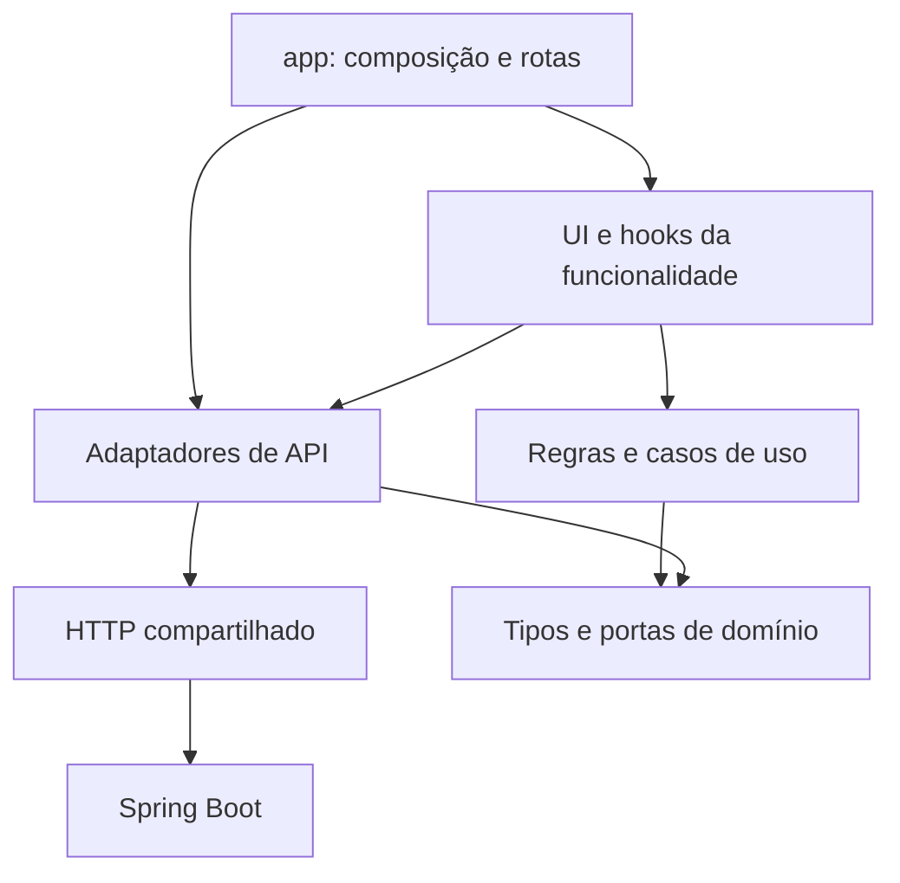

# Arquitetura e guia de leitura

## Organização por funcionalidade

A primeira divisão é pelo que o aluno faz: autenticar, escolher conteúdo, fazer simulados e analisar resultados. Dentro da funcionalidade, separamos os motivos de mudança:

| Parte         | Responsabilidade                               | Exemplo                                                          |
| ------------- | ---------------------------------------------- | ---------------------------------------------------------------- |
| `domain`      | Tipos e regras sem React, DOM ou HTTP          | `weakestSubjects` ignora amostras menores que 5 questões.        |
| `application` | Coordenação de operações e estado de interação | `buildMockExam` sorteia, cria, vincula e compensa falhas.        |
| `api`         | Endpoints, payloads e adaptação                | `createMockExamApi` converte os DTOs Java em questões de sessão. |
| `ui`          | Apresentação e interação                       | `SessionPage` desenha questões e despacha respostas.             |
| `app`         | Composição das instâncias e da aplicação       | `services.tsx`, providers e roteamento.                          |
| `shared`      | Infraestrutura e UI sem um domínio específico  | HTTP, datas, botões e modal.                                     |

Não há obrigação de preencher quatro pastas em cada feature. `dashboard/ui` basta para compor informações existentes. Simulados usam os tipos de catálogo e desempenho diretamente, sem um pacote genérico de modelos que concentre tudo.

As setas representam dependências, não uma obrigação de criar intermediários. Uma consulta simples vai do hook ao adaptador; uma operação com regra e compensação ganha um caso de uso.

## Clean Architecture e SOLID na prática

**Responsabilidade única:** HTTP trata transporte e status; adaptadores tratam contratos; o caso de uso trata montagem; a tela apresenta. A nota pertence ao servidor.

**Inversão de dependência:** `buildMockExam` depende da porta `MockExamBuilderGateway`, com `draw`, `create`, `link` e `remove`. Adaptador real e substituto de teste satisfazem esse contrato. A interface tem benefício imediato: testar ordem, quantidade real e compensação sem rede.

**Segregação de interface:** a porta de montagem não exige autenticação, análise ou métodos que não usa. Consultas simples usam funções tipadas, sem pares artificiais `Repository`/`RepositoryImpl`.

**Clean Architecture proporcional:** regras puras não conhecem bibliotecas; integrações ficam na borda; `app` compõe implementações. `useExamRunner` é um adaptador de apresentação e pode conhecer React e navegação. Não transformamos cada hook em entidade de domínio.

O contexto de serviços fornece instâncias criadas em `app/services.tsx`. As telas usam `useServices` para obtê-las, sem instanciar clientes ou montar cabeçalhos. Esse acesso ao ponto de composição é um compromisso simples para a SPA, sem contêiner genérico de DI.

## Entendendo React

Um componente é uma função que retorna JSX: a descrição da tela. JSX se parece com HTML, mas pode conter valores e outros componentes. `setFilter` pede ao React uma nova renderização; não é preciso localizar o `<select>` e modificá-lo manualmente.

- `useState` mantém estado local.
- `useEffect` sincroniza com algo externo: dados, relógio, eventos. Seu retorno limpa timers e cancela operações.
- `useCallback` estabiliza o loader de `useResource`, evitando refazer a consulta em toda renderização.
- React Context transmite sessão e serviços sem passar cada dependência por todos os componentes intermediários.
- `useSyncExternalStore` observa o armazenamento de sessão, inclusive quando outra requisição recebe `401`.
- `lazy` e `Suspense` dividem as rotas em bundles carregados sob demanda e apresentam o estado de carregamento.

`useResource` mantém carregamento, erro e dado. Ao trocar filtros ou sair da tela, cancela a requisição anterior e ignora sua resposta. Uma consulta lenta não sobrescreve uma seleção recente. Não há cache global de resultados nem atualização periódica, pois o projeto ainda não precisa disso.

`AuthProvider` confirma a identidade com `/auth/me`. `RequireAuth` aguarda essa restauração antes de abrir telas privadas. `StrictMode` ajuda a detectar efeitos sem limpeza; mutações ficam em ações explícitas, e a finalização automática possui uma trava contra duplicação.

## Leia um fluxo completo

1. `mock-exams/ui/builder-page.tsx` controla os campos e apresenta filtros.
2. `application/build-mock-exam.ts` valida nome, quantidade e tempo e solicita o sorteio antes de criar registros.
3. O adaptador chama `/questions/draw`. A quantidade efetivamente recebida é usada em `numQuestions`.
4. Os vínculos são criados sequencialmente. Seus ids fornecem uma ordem estável ao retomar.
5. Falha na vinculação aciona a exclusão do simulado. Se ela falhar, `IncompleteMockExamError` carrega o id para recuperação pelo histórico.
6. A sessão abre, mas o cronômetro só começa ao chamar `/start` por uma ação explícita.

O domínio não importa HTTP. A porta basta para executar `build-mock-exam.test.ts` com respostas controladas.

## Consistência da prova

Recarregar a URL reconstrói a sessão pelo id. A resposta só muda na interface após confirmação do servidor; falhas preservam a última alternativa confirmada. Essa abordagem é um pouco menos imediata em redes lentas, mas dispensa uma fila otimista complexa.

É permitido navegar entre questões durante a gravação: o retorno é aplicado pelo **id do vínculo**, nunca pelo índice visual. Novas respostas e finalização ficam bloqueadas durante a operação. O fechamento automático aguarda a gravação em andamento.

O prazo é `startedAt + maxTime`, interpretado no offset configurado. O relógio é recalculado, não decrementado. Uma aba suspensa recupera o tempo correto ao voltar. Uma falha na finalização apresenta erro e nova tentativa explícita; não entra em repetição infinita. `409` recarrega o estado e redireciona ao resultado se necessário.

O adaptador projeta apenas campos de apresentação para a sessão, removendo `explanation`, `rightAnswer` e `correct`. Isso evita exibi-los durante a prova, mas não corrige o vazamento existente na resposta HTTP da API.

## Sessão e segurança

Token e expiração ficam em `sessionStorage`, permitindo recarregar a aba sem um login persistente indefinido. Se o armazenamento estiver bloqueado, a sessão continua em memória. A identidade é confirmada no servidor, não inferida de claims editáveis no cliente.

O transporte usa Bearer sem cookies. `401` remove a sessão; `403` apresenta acesso negado. Uma resposta de requisição com token antigo não apaga um login novo. Logout tenta revogação e sempre encerra a sessão local, informando quando a revogação não foi confirmada.

`sessionStorage` é acessível a JavaScript e não protege contra XSS. Textos da API são renderizados como texto, sem `dangerouslySetInnerHTML`; o bundle não contém segredo de assinatura. Uma mudança para cookie HttpOnly exigiria evolução conjunta do backend.

## Interface e decisões de simplicidade

Estilos gerais e tokens ficam em `app/styles.css`; estilos específicos acompanham as features. A marca original foi reutilizada. A fonte Manrope é instalada e servida localmente. Lucide fornece os ícones.

O gráfico usa SVG, descrição acessível e tabela alternativa. Formulários usam validação nativa e regras adicionais do contrato. `<dialog>` oferece foco nativo; o menu móvel controla foco, Escape e rolagem do fundo. Textos e ícones complementam cores de status.

Sem Redux, decorators de DI, classes base de repository ou caso de uso para cada GET. Histórico e catálogos usam listas completas da API; a paginação do histórico é visual. A revisão de erros segue fora do MVP.

Referências: [Pensando em React](https://react.dev/learn/thinking-in-react), [Gerenciando estado](https://react.dev/learn/managing-state) e [React Router declarativo](https://reactrouter.com/start/declarative/installation).
